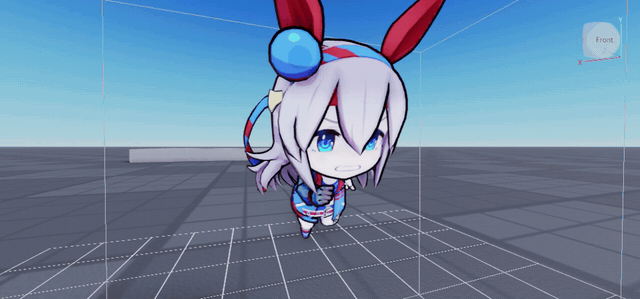
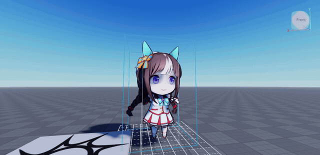

# Uma2Roblox: UmaViewer mini (chibi) models → Roblox Studio, cartoon-shaded

Works with the standalone **[UmaViewer](https://github.com/katboi01/UmaViewer) release app**, wherever you
keep it. UmaViewer is not modified, and its files are not included here.

```
UmaViewer.exe ──Export Model (.pmx + Texture2D)──▶ Uma2Roblox.exe ──.glb──▶ Studio Import 3D ──▶ plugin "Apply Uma Toon"
                                                        ▲                                              │
                                                        └──────────── "Sync" (localhost:34891) ─────────┘
```

## Showcase
Ported minis playing their game animations in Roblox Studio, cel-shaded with outlines, ear motion and facial
expressions:

| Tamamo Cross, run | Hokko Tarumae, reaction |
|---|---|
|  |  |

Every ported clip lands in the **Animation Editor**, ready to preview, tweak and publish:


| The app | The Studio plugin |
|---|---|
|  |  |

## What it does
* Finds UmaViewer automatically if it's next to (or one level above) Uma2Roblox, or in your Documents,
  Desktop or Downloads folder. Otherwise it asks for the folder containing `UmaViewer.exe` on first start
  (you can change it anytime with **Browse…**). It then reads UmaViewer's `Config.json` to find your game data, and lists every character that has a
  **mini** model, read from `master.mdb` and `meta`. **Only not ported** is on by default.
* You queue the characters you want. The app tells you which one to export next from UmaViewer.
* It watches UmaViewer's default save folder (your game data folder), its own `inbox` folder and the
  UmaViewer folder. When a `.pmx` appears it moves it out, copies the textures it needs, and converts it to
  `Uma_<id>_<costume>_<name>.glb` in the output folder (`Documents\Uma2Roblox_Export` by default).
* The Studio plugin applies the final settings and syncs back which characters are now in your place.

## The cartoon look (no Roblox-style shading)
Roblox has no custom shaders, so the look is baked into the model:

| | |
|---|---|
| Anime 2-tone shadow | Cel shadow baked into the texture, using Uma's own `*_shad_c` shadow colour when UmaViewer exported it. **Flat** mode = no shadow at all |
| No Roblox shading gradient | Every vertex normal points up, so Roblox lights the whole model evenly |
| Outline | Inverted-hull `Outline` mesh, skinned to the same bones |
| No cast shadows | Plugin sets `CastShadow = false` |
| No PBR shine | Metal 0 / rough 1, plus an optional place-wide `EnvironmentSpecularScale = 0` button |
| Cheek / eyebrow (mayu) blending | The plugin sets these parts to `Transparency = 0.02`, which moves them to Roblox's transparent render pass so their texture alpha blends properly. It does this on Apply, automatically when an `Uma_*` model is imported, and with the **Fix cheek/mayu transparency** button |
| Cheek / eyebrow (mayu) boxes | UmaViewer's texture export drops their alpha. The background colour is detected from the texture border and keyed out into real alpha, with colours un-blended so soft blush keeps its hue. Configure the parts under *Options → Key out background* |

## Mini animations
UmaViewer can't export mini animations (its VMD recorder only works on normal-size Umas). So with
**Options → Port mini animations** on (the default), the app reads them straight from your game data after
every conversion:
* every clip UmaViewer lists under **Animations → Mini** for that character (`…/chara/chr<id>_…`), plus
  the *General* mini clips if you tick that option
* the encrypted game index and bundles are opened with the keys UmaViewer saved in its own `Config.json`
  (no keys are stored in this tool)
* each looping clip's **start** (`…_s`) and **end** (`…_e`) clips are ported too, as **separate** animations,
  the way UmaViewer plays them: `_s` once → `_loop` looping → `_e` once. In Roblox `_s`/`_e` are
  non-looping *Action* tracks and `_loop` is a looping *Idle* track, so play `_s` then switch to `_loop`
  when it ends (`track.Stopped` / `track.Ended`)
* the clips are decoded, the pose the PMX was exported in is identified (it logs e.g. `export pose: rest pose`),
  and the motion is retargeted onto the GLB's bones → `Uma2Roblox_Export\anims\<model>\*.json`.
  Only **rotations** plus small position deltas (hips etc.) are sent; bone lengths always come from the rig
  in Studio, so the animation fits the imported/uploaded rig's size
* **Ear motion**: each body clip's matching ear clip (`…/body/…/<clip>` → `…/facial/…/<clip>_ear`; the
  `_ear_driven` ones aren't bone motion) is merged in, so ears move with the body. UmaViewer's PMX export drops all
  `Ear*` bones, so with *Options → Ear bones from game rig* on (default) the converter takes the ear bones from the
  mini head/hair prefab in your game data, adds them under `Head` in the GLB, and skins the ear part of the hair to
  them (geometric weights that blend into the head at the ear base). Mini clips have no tail motion.
* **Facial expressions** (no runtime script needed): with *Options → Face expression variants* on (default),
  the converter turns each face part (left/right eye, mouth, left/right mayu) into one mesh holding every
  expression of the atlas: eyes 15, mouth 19, mayu 9. Each variant is a copy with its UVs shifted to its atlas
  cell and its own bone `Face_<part>_<nn>` under `Head`, placed halfway between the part on the face and a point
  inside the head. The default sprite rests on the face (mouth: its second sprite, the small smile; eyes and mayu:
  their first); the others rest turned 180° into the head. Every variant of a part is keyed in each clip, so when
  `_s`/`_loop`/`_e` play as separate tracks, the active one fully owns the face and no old expression shows through. Each body clip's
  `…/facial/…/<clip>_face` track becomes **Constant** keys that turn the shown variant out and the previous one in.
  It's a pure rotation, so it's unaffected by `Model:ScaleTo` (Roblox scales animation translations, never
  rotations). Expressions swap instantly through the normal Animator and preview in the Animation Editor. Keys are only written when an expression changes. The `_face` clips drive locators
  (`Gallop.DrivenKeyAnimation`): `Mouth_Ctrl`, `Eye_L_Ctrl`, `Eye_R_Ctrl`, `Mayu_L_Ctrl`, `Mayu_R_Ctrl` (and `Cheek_Ctrl`),
  whose local **x = −expression index ÷ 100**. One-frame interpolation blips between expressions are dropped.
  Material UV-offset channels are read as a fallback. If a clip uses channels the tool doesn't recognise, the log says
  so and writes `anims\<model>\_face_channels.json` for you to report.
* **Root motion** (*Options → Root motion*): mini clips also move and turn the root `Position` bone through
  the game scene. **inplace** (default) freezes it so the rig stays where it is and keeps only the hip's
  bob and sway, which is what Roblox animations expect. **full** keeps the scene movement, and **none** removes all
  translation. Fine-tune the hip movement in Studio with the plugin's **Root motion scale** (1 = as in game).
  Animations are stored in the model's unscaled units (Roblox's Animator scales them by `Model:GetScale()`), so
  they stay correct at any `Model:ScaleTo` size, including if you rescale the rig after importing them

In Studio, **Apply Uma Toon** then imports them automatically: it fits the bones, builds a `KeyframeSequence` per
clip in `ServerStorage.RBX_ANIMSAVES.<model>` and adds an `AnimationController`. Open them in the
**Animation Editor** to preview, tweak and *Publish to Roblox*. There's also an **Import Uma animations for
selection** button, and **Port animations for converted** in the app for models you converted earlier.

**General animations** (clips not tied to a character, UmaViewer's *Mini → General* list): every mini shares one
skeleton, so they play on any model. Click **General animations…** in the app, search or filter by category
(circle, event, minigame, mode, job) and click rows to pick them. Then either:
* **Attach to next export**: they're ported with the next model you export (tick *Keep picks for every export*
  to add them to every export), or
* **Port now** onto a model you already converted.

Each model remembers its General clips in its sidecar (`"generalClips"`), so re-porting it later keeps them.
**Port animations for converted** adds the current picks to every converted model. From the command line:
```
Uma2Roblox.exe general cir_type00
Uma2Roblox.exe anims Uma2Roblox_Export\Uma_1001_00_Special_Week.json --with anm_min_cir_type00_01_101
```

## Setup (once)
**Easiest, no Python needed:** download `Uma2Roblox-windows-x64.zip` from [Releases](../../releases), extract it
anywhere (next to your UmaViewer folder lets it find UmaViewer without asking), run `install.bat` once for the
Studio plugin, then start `Uma2Roblox.exe`. `Uma2Roblox-cli.exe` is the command-line version (`inspect`, `convert`, …).

**From source:**
1. Install **Python 3.10+** from python.org (tick *Add to PATH*). The build installs numpy, Pillow,
   UnityPy and apsw-sqlite3mc.
2. Double-click **`build_exe.bat`** → builds `Uma2Roblox.exe` in this folder.
   (Or skip building and just use **`run.bat`**.)
3. Double-click **`install.bat`** → installs the Studio plugin; close and reopen your place in Studio (or restart Studio) to load it.

## Porting characters
1. Start **Uma2Roblox.exe** and UmaViewer.
2. In Uma2Roblox, select characters → **Add selected to queue**.
3. In UmaViewer, for the character shown under **NEXT**: open the **Mini** list → pick the character
   and costume → **Settings → Model → Export Model** → **Save**. Keep the suggested `<id>_<name>.pmx` name
   and the default folder. The app converts it within a couple of seconds and moves on to the next one.
4. In Studio: **File → Import 3D** → pick the `.glb` files → Import.
5. Select the imported model(s) → **Uma2Roblox** plugin → **Apply Uma Toon to selection**.
   It turns off shadows, faces the model forward, scales it to the target height (4 studs), and tags
   it `UmaCharaId` / `UmaCostume`.
6. Click **Sync with Uma2Roblox app** (allow the localhost request the first time). Those characters
   are now marked *in Studio* and drop off the "not ported" list.

### Hair, tail and skirt physics (SmartBone 2)
The minis' swing bones (`Sp_*`: hair, tail, ribbons, skirt/jacket, bust) can move with
SmartBone 2 at runtime. SmartBone isn't included here: insert your
copy of the SmartBone 2 ModuleScript into the place (anywhere), then in the plugin click
**Integrate SmartBone 2 into this place**. If it's somewhere unusual, select it in the Explorer first, or enter its
asset id in the panel. The button:
* moves SmartBone to ReplicatedStorage and patches it for the minis' bone axes (the patch only acts on rigs the
  plugin sets up, other SmartBone objects behave as before; tested with SmartBone 2 v0.5.2),
* adds `StarterPlayerScripts.UmaChibiSmartBone`, which gives every model tagged **`UmaChibi`** spring physics
  when it appears in Workspace (ears stay on their animations),
* tags the selected rigs `UmaChibi`, or every Uma rig in the place when none is selected. Imported and Applied
  models get the tag automatically (option **Tag rigs 'UmaChibi' on import and Apply**).

Tune the feel at the top of `UmaChibiSmartBone` (`SETTINGS`, `ROTATION_LIMIT`, `EXCLUDE`), or per rig with
SmartBone attributes on its RootPart (`Stiffness`, `Damping`, `Gravity`, …); attributes already set win.

Already have PMX files? Use **Convert PMX file…**, or from the command line:
```
Uma2Roblox.exe convert "1001_Special Week.pmx"
Uma2Roblox.exe list --unported
Uma2Roblox.exe anims Uma2Roblox_Export\Uma_1001_00_Special_Week.json
```

**Diagnostics:** `inspect` writes a small JSON report of what a character's mini clips animate (body, `_face`,
`_ear` and the `_driven` variants): bone/renderer names, channel ids and sample values. It contains no asset data.
```
py -3 uma2roblox.py inspect 1001
py -3 uma2roblox.py inspect "<game data>\dat\AB\ABCDEF…"   (raw files from the dat folder)
```

## Notes
* UmaViewer plays an idle animation on minis, and the export is taken from the pose on screen.
  That pose becomes the rest pose in Roblox, so pause or pose the model first if you care about it.
* If the meta DB is encrypted (newer game versions), mini availability can't be checked and all
  characters are listed. Ones without a mini simply won't export as one. The app warns when a PMX is a full-size model.
* Mini eyes, mouth and eyebrows export with the expression UmaViewer is showing. Facial (texture-swap)
  animations aren't ported, only body/bone motion.
* For animations, export the PMX right after loading the mini without picking another animation, so the export
  pose can be recognised. If the app logs a large fit error, re-export.
* Roblox can't turn off *receiving* shadows per part.
* Uma Musume assets are © Cygames. Keep exports for personal use and check Roblox's terms before uploading.

## Files
* `u2r/`: the app (`pmx.py` reader, `convert.py` toon/GLB converter, `catalog.py` characters,
  `gamedata.py` meta/bundle reading, `anim.py` clip decoding + retargeting,
  `registry.py` ported list + Studio sync server, `gui.py`)
* `roblox/Uma2Roblox.plugin.lua`: Studio plugin
* `tests/`: `make_test_pmx.py` (fake UmaViewer-style PMX), `test_anim.py`, `test_pipeline.py`
* `extras/unity-editor-tool/`: optional variant for the UmaViewer *source* project in Unity

## License
The source code is MIT-licensed (see `LICENSE`). Game content is © Cygames and is **not** covered.
See `NOTICE.md`: this repo contains no game assets, UmaViewer files or keys, and you must not
redistribute anything the tool produces.
